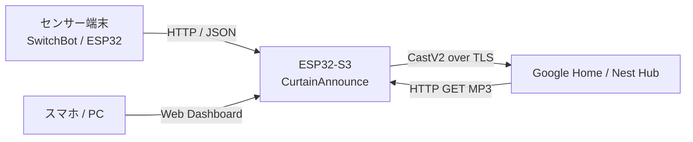

# CurtainAnnounce (窓とカーテン開閉予測システム)

[English](#english-overview) | **日本語**

> ⚡ **ステータス: 稼働テスト完了・実稼働中**  
> ESP32-S3 単体での Google Home 連携・キャスト送信、温熱予測ロジック、および Web 管理画面の実装と検証が完了しました。

---

ESP32-S3 を使用した **温熱効率ベースの窓とカーテン開閉予測・音声アナウンスシステム** です。  
屋外の光量（照度）および外気温データを同一 LAN 内のセンサー API から取得し、室内の温熱環境への影響を時系列変化（傾きトレンド）から予測。冷暖房効率が最大化する最適なタイミングで、Google Home / Nest Hub へ音声をキャスト（通知）します。

さらに、内蔵 Web サーバーにより、PC やスマートフォンのブラウザからリアルタイムのセンサー状態（窓・カーテンの推定状態、外気温、室温、照度）や過去のアナウンス履歴の確認、テスト音声の再生が可能です。

---

## 1. 主な機能・特徴

- **完全スタンドアロン CastV2 クライアント**:
  - Python や外部サーバー（Home Assistant 等）を介さず、ESP32-S3 単体で Google Cast プロトコル（CastV2 over TLS / ポート 8009）を実装。
  - Default Media Receiver（`CC1AD845`）の動的起動、`transportId` の自動抽出、メディア `LOAD` 要求を内蔵。
- **温熱効率予測ロジック**:
  - 過去30分間（6サンプル）の移動平均と変化率（傾き）を計算し、先読み判定。
  - **冬・採光（開）**: 日差しが入り外気温が上昇し始めたら、カーテンを開けて太陽熱で暖房負荷を低減。
  - **冬・断熱（閉）**: 日没前兆（光量急減）を検知したら、冷え込む前にカーテンを閉めて窓からの熱流出を抑制。
  - **夏・遮熱（閉）**: 直射日光の急増を検知したら、カーテンを閉めて室温上昇を防止。
  - **夏・排熱（開）**: 夕方〜夜間に外が涼しくなったら、カーテンを開けて熱気を逃がす。
  - **冬春・日中換気（窓開け）**: 暖かく日差しの心地よい時間帯（11:00〜14:00、外気温≧20℃）に、空気の入れ替えを促す。
  - **冬春・冷え込み窓閉め**: 窓が開いている時、雨や天候急変で室温≦20℃・(外気温+3℃)＜室温に冷え込んだ際、または16:00以降に窓を閉めて暖気を閉じ込める。
  - **夏秋・夕涼み（窓開け・ナイトパージ）**: 夕暮れ時に外気温が室温より低くなったタイミング（室温≧25℃、外気温＜室温-2℃）で、涼しい外気を取り込み大幅節電。
  - **夏朝・外気逆転（窓閉め）**: 朝日とともに外気温が室温を追い抜いた瞬間（温度クロスオーバー検知）に、窓を閉めて涼しさを閉じ込め冷房効果を向上。
- **誤報・チャタリング防止ガード**:
  - 推定カーテン・窓開閉状態（デュアル・ステートマシン）による同方向通知の抑止。
  - 各種窓換気アクションの1日1回限定制御（`tm_yday` による日次追跡）。
  - アナウンス後 1 時間のクールダウンタイマー（雲の通過等による連続通知防止）。
  - 深夜・早朝（22:00 〜 07:00）のおやすみ時間帯自動スキップ。
- **内蔵 Web ダッシュボード**:
  - リアルタイム状態表示（カーテン状態、窓状態、外気照度、外気温、室温）。
  - 最新 20 件のアナウンス履歴一覧（日時、アクション、センサー値、キャスト結果）。
  - Google Home へのワンタップ・テスト再生ボタン。
  - SPIFFS 内蔵音声ファイル（MP3 9種類）のブラウザ試聴プレイヤー。
- **常時稼働・超低消費電力**:
  - 平均消費電力 **約 0.2 W（電気代：約 4.5 円/月、約 54 円/年）**。USB 常時給電でスリープ不要、いつでも即座に応答。

---

## 2. システム構成



| 項目 | 内容 |
| :--- | :--- |
| **マイコン** | ESP32-S3（ESP32-S3 SuperMini / DevKitC 等、Flash 4MB 以上） |
| **フレームワーク** | ESP-IDF v5.4 |
| **通知先** | Google Home / Google Nest Hub（ポート 8009） |
| **データソース** | ローカル REST API（`http://esp32-switchbot.local/api/sensor` 等） |
| **消費電力** | 約 0.15 〜 0.25 W（待機時）/ ピーク 約 0.8 W（キャスト時） |

---

## 3. ディレクトリ構成

```text
CurtainAnnounce/
├── CMakeLists.txt
├── partitions.csv              # カスタムパーティション (Factory 1.8MB / SPIFFS 2.0MB)
├── sdkconfig.defaults          # ESP32-S3 設定、TLS insecure/skip-verify
├── esp32s3_curtain_announce_spec.md # 詳細仕様書
├── data/                       # SPIFFS 格納用 MP3 音声ファイル
│   ├── test.mp3                # テスト発話
│   ├── win_open.mp3            # 冬・採光（開）
│   ├── win_close.mp3           # 冬・断熱（閉）
│   ├── sum_open.mp3            # 夏・排熱（開）
│   ├── sum_close.mp3           # 夏・遮熱（閉）
│   ├── mid_vent.mp3            # 冬春・日中換気（窓開け）
│   ├── night_purge.mp3         # 夏秋・夕涼み（窓開け）
│   └── morning_close.mp3       # 夏朝・外気逆転（窓閉め）
└── main/
    ├── app_config.h            # 各種しきい値・動作パラメータ設定
    ├── secrets.example.h       # Wi-Fi / IP / API URL テンプレート
    ├── secrets.h               # プライベート設定 (git 管理外)
    ├── wifi_manager.c/.h       # Wi-Fi STA & mDNS 初期化
    ├── ntp_client.c/.h         # SNTP 時刻同期 (JST-9)
    ├── spiffs_storage.c/.h     # SPIFFS ファイルシステム初期化
    ├── http_server.c/.h        # Web ダッシュボード & MP3 配信サーバー
    ├── data_fetcher.c/.h       # センサーデータ HTTP/JSON ポーリング
    ├── thermal_logic.c/.h      # 温熱予測ロジック & ステートマシン
    ├── announce_history.c/.h   # 最新20件のアナウンス履歴管理
    ├── cast_client.c/.h        # CastV2 (TLS / Protobuf) キャスト送信
    └── main.c                  # メインエントリ & 監視ループタスク
```

---

## 4. ビルド & セットアップ手順

### 4.1 資格情報の設定
`main/secrets.example.h` を `main/secrets.h` にコピーし、ご使用の環境に合わせて設定してください（`secrets.h` は `.gitignore` に登録されており Git にコミットされません）。

```bash
cp main/secrets.example.h main/secrets.h
```

`main/secrets.h`:
```c
#define CONFIG_WIFI_SSID            "YOUR_WIFI_SSID"
#define CONFIG_WIFI_PASSWORD        "YOUR_WIFI_PASSWORD"
#define CONFIG_GOOGLE_HOME_IP       "192.168.11.7"
#define CONFIG_WEATHER_API_URL      "http://esp32-switchbot.local/api/sensor"
```

### 4.2 ビルドとフラッシュ

ESP-IDF 環境をロードしてビルド・書き込みを実行します：

```bash
# ESP-IDF 環境の有効化 (環境に合わせてパスを指定)
source ~/esp/esp-idf/export.sh

# ビルド
idf.py build

# ESP32-S3 へ書き込み & ログ監視
idf.py -p /dev/ttyACM0 flash monitor
```

起動後、ESP32-S3 に割り当てられた IP アドレス（例：`http://192.168.11.22/`）へブラウザからアクセスすると、Web 管理画面が表示されます。

---

<a name="english-overview"></a>
## English Overview

**CurtainAnnounce** is an autonomous thermal-predictive curtain announcement system running standalone on an **ESP32-S3** microcontroller.

### Key Highlights
- **Standalone CastV2 over TLS**: Direct communication with Google Home / Nest Hub devices without any third-party gateway or bridge.
- **Predictive Thermal Logic**: Analyzes 30-minute rolling light (lux) and outdoor temperature trends to forecast indoor heat gain/loss and recommend optimal curtain actions.
- **Embedded Web Dashboard**: Modern responsive web dashboard served directly from ESP32-S3 with real-time status updates, announcement history (last 20 events), one-click test casting, and in-browser audio previews.
- **Energy Efficient**: Runs 24/7 on USB power drawing only ~0.2W (~54 JPY / ~$0.35 USD per year).

---

## ライセンス / License

MIT License
